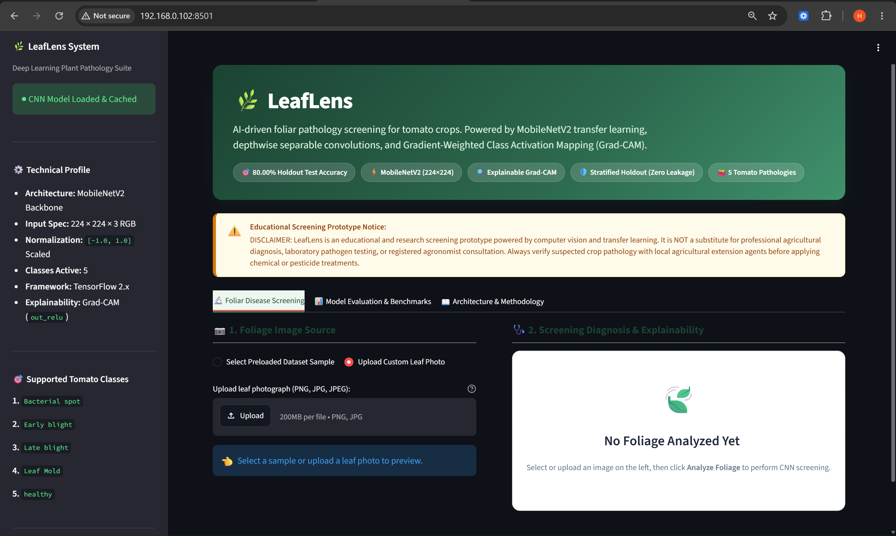
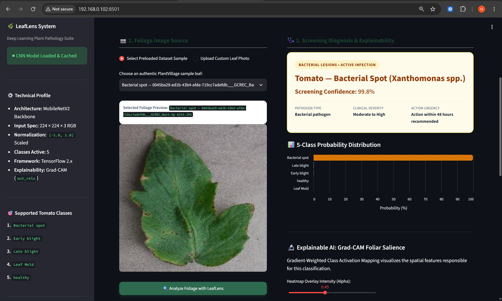
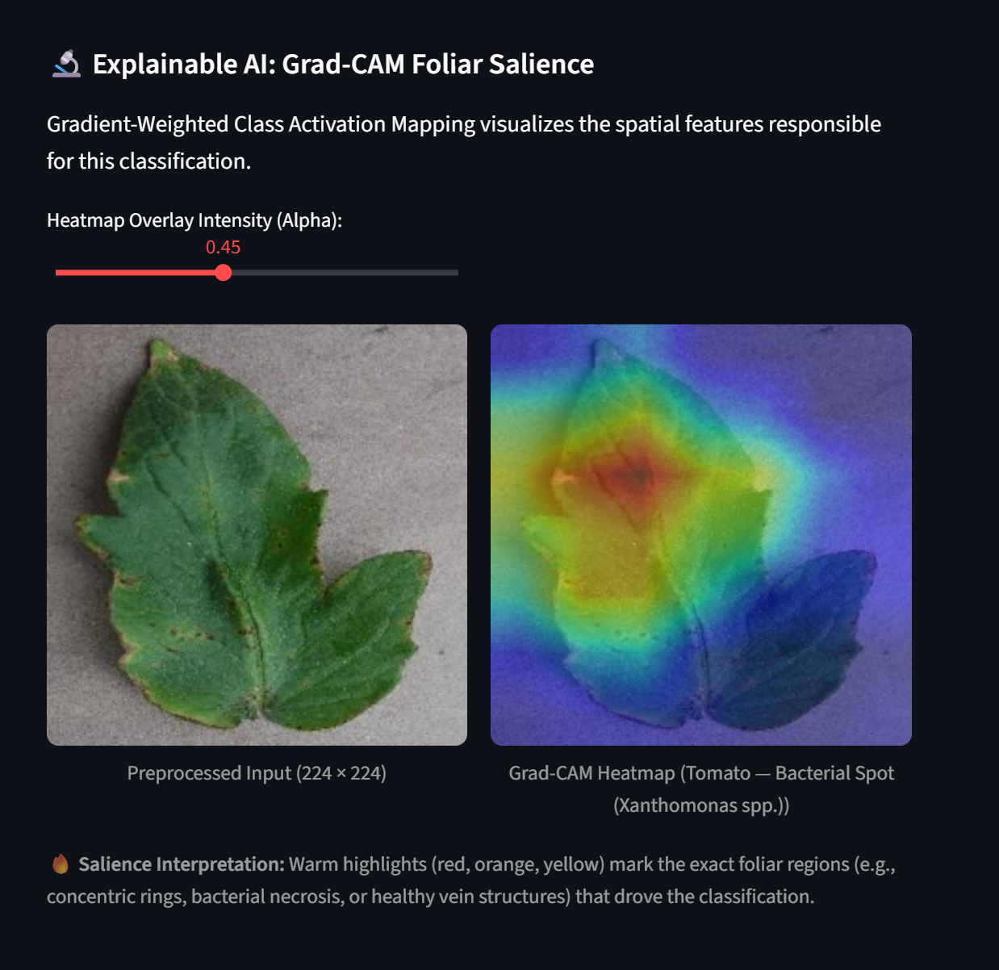
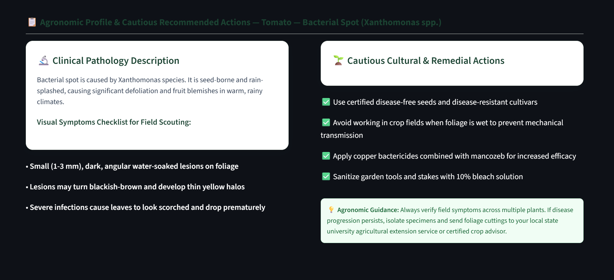
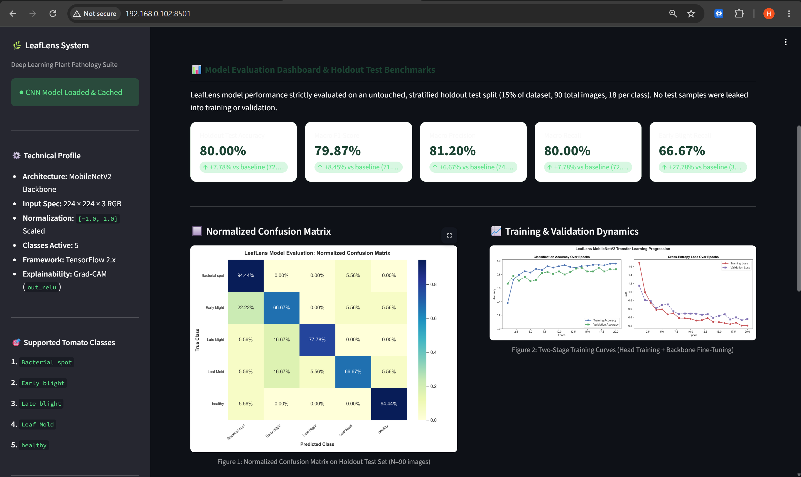
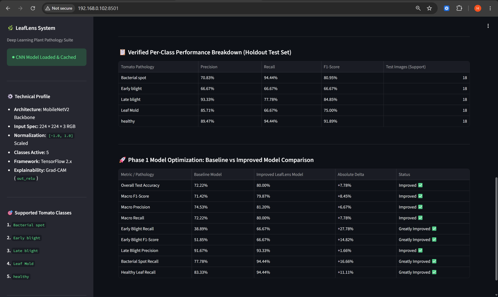

<div align="center">

# LeafLens

### Plant Disease Screening with Deep Learning and Transfer Learning

A Streamlit application for classifying five tomato leaf categories using **MobileNetV2**, with **Grad-CAM visualizations** to help inspect model attention.

[](https://www.python.org/)
[](https://www.tensorflow.org/)
[](https://streamlit.io/)
[](artifacts/evaluation_metrics.json)
[](artifacts/evaluation_metrics.json)

</div>

---

## Overview

**LeafLens** is an educational computer-vision project that classifies tomato leaf images into five categories. It combines a MobileNetV2 transfer-learning model with a Streamlit interface, class-probability visualizations, and Grad-CAM heatmaps.

The repository includes the application code, trained model checkpoints, evaluation artifacts, screenshots, and scripts for downloading a small PlantVillage image subset, training, evaluation, and verification.

> **Important:** LeafLens is a screening prototype, not a definitive plant-disease diagnosis system. The reported evaluation uses a small, curated image subset. Performance on real farm images has not been established.

## Features

- **Five-class prediction:** Bacterial Spot, Early Blight, Late Blight, Leaf Mold, and Healthy.
- **Transfer learning:** MobileNetV2 pretrained on ImageNet, with a custom classification head.
- **Image upload:** Analyze supported image formats through the Streamlit interface.
- **Class probabilities:** View the model's predicted probability for each category.
- **Grad-CAM:** Generate a heatmap to inspect image regions associated with a prediction.
- **Evaluation dashboard:** View saved evaluation metrics, a confusion matrix, and training curves.
- **Plant-health information:** Browse disease symptoms and general management guidance.
- **Reproducible scripts:** Download the dataset subset, train the model, evaluate it, and run verification scripts.

## Supported classes

| Class | Dataset label |
|---|---|
| Bacterial Spot | `Tomato___Bacterial_spot` |
| Early Blight | `Tomato___Early_blight` |
| Late Blight | `Tomato___Late_blight` |
| Leaf Mold | `Tomato___Leaf_Mold` |
| Healthy | `Tomato___healthy` |

The class mapping used by the saved model is stored in `models/class_names.json`.

## Screenshots

### Screening and predictions

| Main dashboard | Prediction results |
|---|---|
|  |  |

### Explainability and guidance

| Grad-CAM | Disease guidance |
|---|---|
|  |  |

### Evaluation

| Evaluation dashboard | Model comparison |
|---|---|
|  |  |

## Model and workflow

LeafLens uses transfer learning with MobileNetV2. The model accepts RGB leaf images resized to `224 × 224` pixels and applies MobileNetV2-compatible normalization to the input.

The documented workflow is:

1. Download and organize the five tomato-leaf image classes.
2. Create stratified training, validation, and test partitions.
3. Train a classification head with the pretrained backbone frozen.
4. Fine-tune selected backbone layers at a lower learning rate.
5. Evaluate the selected checkpoint on the holdout test partition.
6. Use the trained model for predictions and Grad-CAM visualizations.

The implementation details are defined in `model.py`, `data_loader.py`, `train.py`, `evaluate.py`, and `gradcam.py`.

### Grad-CAM interpretation

Grad-CAM highlights image regions that influence a model's class score. It can help inspect predictions, but it does **not** prove that the model has learned causal disease features or that its prediction is correct.

## Reported evaluation

The current project artifacts and original experiment report the following results for the improved model:

| Metric | Reported result |
|---|---:|
| Accuracy | 80.00% |
| Macro precision | 81.20% |
| Macro recall | 80.00% |
| Macro F1-score | 79.87% |

The report describes a **90-image holdout test set**, with 18 images per class, drawn from a curated subset of 600 images (120 per class). The baseline model is reported at 72.22% accuracy.

These are the project's reported results, not an independent benchmark. A test set of this size gives limited evidence about generalization. Images from a controlled dataset may differ substantially from field photographs. For serious evaluation, use larger and independently collected data, including images from varied growing conditions and backgrounds.

Saved outputs include:

- `artifacts/evaluation_metrics.json`
- `artifacts/confusion_matrix.png`
- `artifacts/training_curves.png`
- `artifacts/training_history.json`
- `artifacts/experiment/`
- `artifacts/experiment2/`
- `artifacts/verification_cam/`

## Repository structure

```text
LeafLens/
├── app.py
├── model.py
├── train.py
├── evaluate.py
├── data_loader.py
├── download_data.py
├── disease_info.py
├── gradcam.py
├── test_5_classes.py
├── verify_all.py
├── requirements.txt
├── models/
│   ├── best_model.keras
│   ├── best_model_baseline.keras
│   └── class_names.json
├── artifacts/
│   ├── evaluation_metrics.json
│   ├── confusion_matrix.png
│   ├── training_curves.png
│   └── ...
└── docs/
    └── screenshots/
```

The dataset directory is not included in this GitHub repository. Download it locally using the script below.

## Setup

### Requirements

- Git
- Python 3.10, 3.11, or 3.12 recommended
- A compatible TensorFlow installation for your Python version and operating system

TensorFlow compatibility depends on the specific Python version and platform. If installation fails, check the official [TensorFlow installation guide](https://www.tensorflow.org/install/pip).

### 1. Clone the repository

```powershell
git clone https://github.com/Harsha69420/LeafLens.git
cd LeafLens
```

### 2. Create and activate a virtual environment

```powershell
py -3.11 -m venv .venv
.\.venv\Scripts\Activate.ps1
```

If PowerShell blocks activation, you can allow scripts for the current terminal session:

```powershell
Set-ExecutionPolicy -Scope Process -ExecutionPolicy Bypass
.\.venv\Scripts\Activate.ps1
```

If Python 3.11 is not installed, use an installed Python version supported by the TensorFlow release you plan to install.

### 3. Install dependencies

```powershell
python -m pip install --upgrade pip
pip install -r requirements.txt
```

### 4. Download the dataset subset

The downloader targets five tomato classes from the [PlantVillage dataset repository](https://github.com/spMohanty/PlantVillage-Dataset), with up to 120 images per class.

```powershell
python download_data.py data/plantvillage_subset 120
```

Check the output of the script and confirm the five class directories were created. Dataset availability and upstream repository structure can change. Follow the dataset source's terms and attribution requirements.

### 5. Launch the app

```powershell
streamlit run app.py
```

Streamlit normally serves the application at `http://localhost:8501`.

The trained checkpoint and class mapping are expected at:

- `models/best_model.keras`
- `models/class_names.json`

The repository includes the model checkpoint, so training is not required just to try inference. The app may also use local dataset samples for its sample-selection interface; download the dataset if those features require it.

## Useful commands

### Run the verification script

```powershell
python verify_all.py
```

### Test predictions and Grad-CAM for five classes

```powershell
python test_5_classes.py
```

### Evaluate the trained model

```powershell
python evaluate.py --model models/best_model.keras --data data/plantvillage_subset --split test --output artifacts
```

Run evaluation only after the dataset has been downloaded and check the script's arguments if your local version differs.

### Retrain the model

```powershell
python train.py --epochs_stage1 12 --epochs_stage2 8 --batch_size 32
```

Training can take time and may require substantial memory. Check the scripts for available arguments and defaults before starting a long run.

## Troubleshooting

**TensorFlow cannot be installed**

Check your Python version and operating system against the official TensorFlow installation instructions. Use a supported Python/TensorFlow combination rather than assuming every TensorFlow release works on every Python version.

**The model file is missing**

Confirm that `models/best_model.keras` exists. If it has been removed, retraining may recreate a checkpoint, depending on the implementation in `train.py`.

**Dataset or sample images are missing**

Run `python download_data.py data/plantvillage_subset 120` and verify that each of the five class folders contains images.

**Port 8501 is already in use**

```powershell
streamlit run app.py --server.port 8502
```

**PowerShell will not activate the environment**

Run the process-scoped execution policy command in the setup section, then activate the virtual environment again.

## Limitations and future work

- **Limited dataset:** The current experiment uses a small subset of PlantVillage images.
- **Domain shift:** Performance on natural field images has not been established.
- **Class confusion:** Visually similar symptoms can lead to incorrect predictions.
- **Interpretability:** Grad-CAM is a visualization aid, not proof of model reasoning.
- **Future improvements:** Evaluate on independent field datasets, expand class coverage, improve calibration, and explore model quantization for edge deployment.

## Educational disclaimer

LeafLens is intended for educational and research use. Predictions and management guidance may be incorrect and should not be treated as a confirmed diagnosis or as a substitute for advice from a qualified agricultural specialist. Do not make costly or irreversible crop-treatment decisions solely from this application.

## Dataset and acknowledgements

- **PlantVillage:** D. P. Hughes and M. Salathé, “An open access repository of images on plant health to enable the development of mobile disease diagnostics,” 2015. [Dataset repository](https://github.com/spMohanty/PlantVillage-Dataset).
- **MobileNetV2:** M. Sandler et al., “MobileNetV2: Inverted Residuals and Linear Bottlenecks,” CVPR 2018.
- **Grad-CAM:** R. R. Selvaraju et al., “Grad-CAM: Visual Explanations from Deep Networks via Gradient-Based Localization,” ICCV 2017.
- **Streamlit:** For the application framework.

## License

No open-source licence is currently included in this repository. Until a licence is added, do not assume that others have permission to redistribute or reuse the code. If you intend to publish the code under an open-source licence, add a `LICENSE` file and verify that it is compatible with any third-party code, model weights, and dataset terms.
